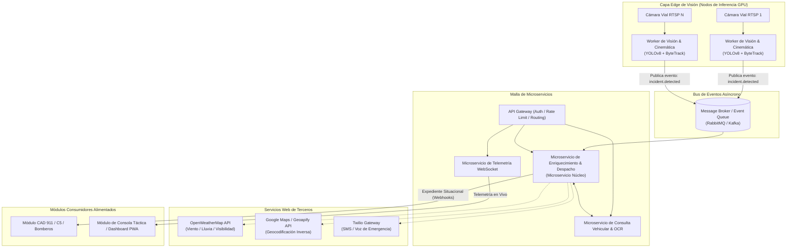

# Análisis de Producto y Arquitectura de Microservicios: Accident-Detector

Este documento consolida el análisis técnico, arquitectónico y operativo para la transición de **Accident-Detector** desde un prototipo monolítico hacia un producto de software comercial y distribuido (SaaS B2G/B2B para centros de control C5, cabinas 911 y concesionarias viales).

---

## 1. Identificación del Proyecto e Historias de Usuario

* **Nombre del Proyecto:** Accident-Detector (Sistema Inteligente de Detección de Incidentes Viales)
* **Historias de Usuario Principales:** (Documentadas en detalle en [user_storie.md](file:///c:/Dev/Accident-Detector/user_storie.md))
  * **US-01 (Operador de Monitoreo):** Detección automática de colisiones vehiculares en tiempo real mediante visión computacional y análisis cinemático ($\Delta v$ en $\Delta t < 0.5\text{ s}$).
  * **US-02 (Despachador de Bomberos):** Reconocimiento de fuego y humo con persistencia temporal y disparo de alarma acústica/táctica.
  * **US-03 (Coordinador 911 / CAD):** Despacho automatizado de alertas enriquecidas con geocodificación legible, meteorología y SMS.
  * **US-04 (Primer Respondiente / Rescate):** Ficha técnica vehicular, riesgo de propulsión eléctrica y validación de reporte de robo.

---

## 2. Resolución del Problema mediante Microservicios y Diagrama Arquitectónico

### Problemática de la Arquitectura Monolítica
1. **Acoplamiento de cargas GPU vs I/O:** El procesamiento visual en tiempo real requiere ciclos intensivos de GPU/CPU. Si una consulta externa (clima o geocodificación) sufre latencia, un monolito congela el bucle de captura y pierde frames críticos.
2. **Escalabilidad asimétrica costosa:** Monitorear 100 cámaras viales requiere múltiples nodos de inferencia, pero solo una instancia del orquestador de despacho. En un monolito se tendría que replicar todo el sistema completo.
3. **Punto único de falla:** Una caída de red en las notificaciones no debe detener la vigilancia de tráfico.

### Solución con Microservicios
* **Desacoplamiento funcional:** La inferencia visual se ejecuta en nodos Edge con GPU; el enriquecimiento y despacho se gestionan en microservicios backend ligeros.
* **Comunicación Asíncrona:** Los incidentes se publican en una cola de mensajes (Message Broker) para ser consumidos y procesados sin bloquear el streaming de video.

### Diagrama de Arquitectura



---

## 3. Módulo Alimentado por Nuestro Propio Microservicio (Evidence 3)

* **Microservicio Propio:**  
  `Microservicio de Enriquecimiento Situacional y Despacho de Incidentes` (*Incident Enrichment & Dispatch Service*).
* **Módulo que alimenta:**  
  **Módulo de Despacho Táctico y Asistencia de Emergencias** (Consumido por sistemas **CAD 911 / C5 / Concesiones de Autopistas**) y el **Módulo de Consola Operativa en Tiempo Real** (Dashboard PWA).
* **Justificación de la integración:**  
  El microservicio recibe la señal binaria/cinemática de la cámara y la transforma en un **Expediente Situacional de Emergencia Normalizado**, entregando:
  1. Geocodificación inversa (calle exacta y cruces viales, no solo coordenadas crudas).
  2. Factores ambientales críticos (dirección de vientos para dispersión de humo, estado de lluvia/pavimento).
  3. Perfil de riesgo del vehículo (tipo de propulsión eléctrica o gasolina).

---

## 4. Definición de los Primeros Tres Endpoints

### Endpoint 1: Ingesta, Evaluación y Despacho de Incidente
* **Método:** `POST`
* **URL:** `/api/v1/incidents/evaluate-and-dispatch`
* **Input (Request Body):**
```json
{
  "camera_id": "CAM-CDMX-PERIFERICO-04",
  "timestamp": "2026-10-21T23:15:30.450Z",
  "incident_type": "critical_collision",
  "confidence": 0.94,
  "telemetry": {
    "initial_speed_kmh": 78.5,
    "impact_speed_kmh": 0.0,
    "delta_time_sec": 0.38,
    "has_fire": false,
    "has_smoke": true
  },
  "detected_plate": "ABC-1234",
  "frame_snapshot_url": "https://storage.incidentdetector.io/snapshots/20261021/snap_cam04_9921.jpg"
}
```
* **Output (Response Body - 201 Created):**
```json
{
  "status": "dispatched",
  "incident_id": "INC-2026-004812",
  "severity_level": "ALTO",
  "location": {
    "street": "Anillo Periférico Sur y Av. Insurgentes Sur",
    "neighborhood": "Tlalpan",
    "coordinates": {"lat": 19.3012, "lon": -99.1824}
  },
  "environmental_risk": {
    "weather": "Lluvia Ligera",
    "pavement_status": "Pavimento Mojado",
    "wind_speed_kmh": 22.4,
    "smoke_dispersion_direction": "Noreste"
  },
  "dispatch_notifications": {
    "cad_911_ticket_id": "CAD-911-MEX-88192",
    "status": "DELIVERED"
  }
}
```
* **Status Codes:** `201 Created`, `400 Bad Request`, `401 Unauthorized`, `422 Unprocessable Entity`, `503 Service Unavailable`.

---

### Endpoint 2: Consulta de Expediente Situacional por Incidente
* **Método:** `GET`
* **URL:** `/api/v1/incidents/{incident_id}/situational-dossier`
* **Parámetros:** Path: `incident_id` (string) | Query: `include_video_clip` (bool, default `false`).
* **Output (Response Body - 200 OK):**
```json
{
  "incident_id": "INC-2026-004812",
  "status": "EN_ATENCION_MEDICA",
  "timeline": {
    "detected_at": "2026-10-21T23:15:30.450Z",
    "dispatched_at": "2026-10-21T23:15:31.120Z"
  },
  "hazard_assessment": {
    "fire_risk": "BAJO",
    "electric_vehicle_hazard": false
  },
  "media_evidence": {
    "snapshot_url": "https://storage.incidentdetector.io/snapshots/20261021/snap_cam04_9921.jpg",
    "evidence_video_mp4_url": "https://storage.incidentdetector.io/clips/20261021/clip_cam04_9921.mp4"
  }
}
```
* **Status Codes:** `200 OK`, `404 Not Found`, `500 Internal Server Error`.

---

### Endpoint 3: Consulta y Validación de Historial Vehicular y Nivel de Riesgo
* **Método:** `POST`
* **URL:** `/api/v1/vehicles/risk-assessment`
* **Input (Request Body):**
```json
{
  "plate": "ABC-1234",
  "vin": "3N1AB7AP6NL123456",
  "jurisdiction": "CDMX"
}
```
* **Output (Response Body - 200 OK):**
```json
{
  "plate": "ABC-1234",
  "vehicle_found": true,
  "specifications": {
    "brand": "Nissan",
    "model": "Versa",
    "year": 2022,
    "fuel_system": "Gasolina",
    "is_electric_or_hybrid": false
  },
  "legal_status": {
    "stolen_report": false,
    "repuve_status": "VIGENTE_SIN_REPORTES"
  },
  "rescue_instructions": "Protocolo de extricación estándar. Corte de batería auxiliar de 12V en cofre delantero."
}
```
* **Status Codes:** `200 OK`, `400 Bad Request`, `422 Unprocessable Entity`, `502 Bad Gateway`.

---

## 5. Servicio Web de Terceros Integrado y Justificación

* **Servicio Web:** **OpenWeatherMap API** (o **WeatherAPI**).
* **Justificación técnica y operativa:**
  1. **Dispersión de humo y sustancias tóxicas:** Provee velocidad y dirección vectorial del viento en tiempo real, permitiendo al sistema predecir el avance del humo hacia carriles contrarios o zonas residenciales para indicar rutas seguras a los bomberos.
  2. **Análisis de fricción del pavimento:** Obtiene datos de precipitación y heladas, advirtiendo a las ambulancias sobre riesgo de derrape (*hidroplaneo*) en la ruta de aproximación al siniestro.

---

## 6. Matriz de Riesgos por Componente y Estrategias de Mitigación

| Componente | Riesgo Identificado | Estrategia de Mitigación |
| :--- | :--- | :--- |
| **1. Pipeline de Visión e Inferencia (Edge / YOLOv8)** | **Falsos positivos por sombras, reflejos o vapor de escape:** Disparo erróneo de alarmas de fuego o choque. | **Validación temporal y cinemática cruzada:** Exigir persistencia de fuego/humo por $\ge 8$ frames consecutivos con confianza $> 0.65$ y condicionar colisión a $\Delta v > 40\text{ km/h}$ en $\Delta t < 0.5\text{ s}$. |
| **2. Microservicio de Enriquecimiento y Despacho** | **Saturación ante siniestros simultáneos durante tormentas:** Cuellos de botella en peticiones concurrentes. | **Arquitectura asíncrona desacoplada:** Uso de Message Broker (RabbitMQ/Redis Streams) y workers asíncronos en FastAPI/Celery escalables horizontalmente. |
| **3. APIs Externas (Clima / Mapas)** | **Caída o alta latencia del proveedor (*Downtime* / Timeout):** Demora del despacho de rescate por indisponibilidad de terceros. | **Patrón *Circuit Breaker* + Caché con *Graceful Degradation*:** Timeout estricto a 1.5 s y caché geográfica TTL. Si la API falla, la alerta se despacha de inmediato con datos básicos sin frenar el flujo. |
| **4. Servicio de Notificaciones (Twilio / Webhooks)** | **Fallo de entrega de SMS por congestión celular:** Falta de aviso inmediato a unidades médicas en campo. | **Despacho multicanal redundante con Fallback:** Envío simultáneo: 1) Webhook directo a CAD 911, 2) Notificación Push PWA, y 3) SMS de respaldo vía Twilio. |
| **5. Frontend / PWA Táctica del Operador** | **Pérdida de conectividad Wi-Fi/4G en campo:** Desconexión de la tableta de patrulla o ambulancia. | **Service Worker Offline y WebSocket resiliente:** Carga de interfaz desde caché local y reconexión automática con *exponential backoff* y buffer de eventos en IndexedDB. |
